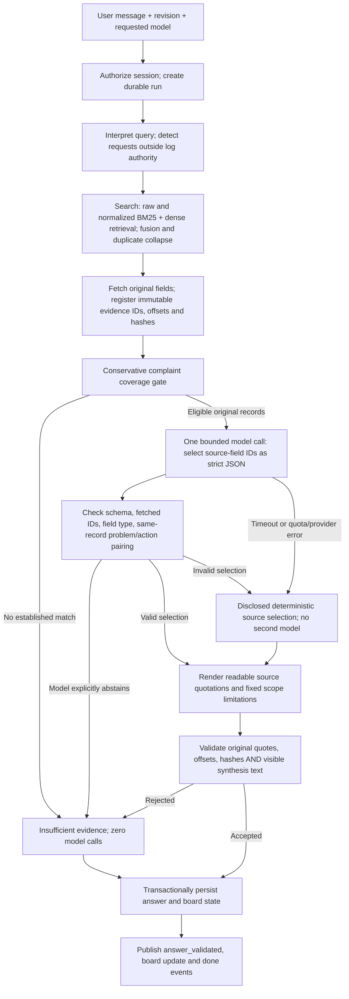

# Evidence harness and model/prompt policy

## Actual execution loop

The conversational loop repeats this pipeline for each submitted message. Normal Evidence mode uses server-directed search/get-record tools followed by **one** model request. It does not ask a model to rediscover evidence already fetched. The older native `roundtrip_tool_loop` remains a bounded helper for other caller paths; it is not the normal Evidence path. Independent action endpoints have their own services; this change does not implement Challenge/Sensitivity or repair the separate visual routing.

SSE streams actual progress and durable event IDs. The factual answer is withheld until validation and persistence; raw thought streams and unvalidated answer tokens are not shown. Session history exists, but conversational referent resolution remains a separate limitation noted in the audit.

## Prompt and output contract

The active Evidence prompt is `docs/prompts/evidence_selection_v2.md` (version `evidence-selection/v2`), sent as a system message. The user turn is a JSON data packet with the complaint and fetched original evidence fields. The general `maintenance_system_prompt.md` is still used by the older generic agent path; editing only that file would not improve the normal Evidence selection call.

The selector must account for the entire complaint, distinguish unknown/missing/contradicting qualifiers, pair actions only with the same record, respect negation/side/number, preserve description-only facility records and abstain for unsupported specifications or operational clearance. Few-shot boundary examples cover wrong-side brakes, intake-gasket records, compound complaints and source-instruction injection. Record IDs never establish identity, chronology or recurrence; replacement never establishes success.

Output is **only** a strict object with `decision` and up to two `records`; each record contains a fetched problem/description evidence UUID and zero or one same-record action UUID. No model-written summary, invented explanation, quote, offset or hash is accepted through this endpoint. The server assembles readable quoted summaries, cited claims and fixed limitations from checked fields. This is a deliberate grounding boundary: models can help select sources and abstain, but cannot insert fluent unsupported facts into the public synthesis.

`AnswerEnvelope.synthesis_evidence_ids` lets the final validator reconstruct the approved visible text and reject mutations of summary, conclusions or limitations. Exact span/hash checks still apply to historical claims. The old substring heuristic equating CRACK/LEAK with passed operational checks has been removed. Source text is escaped in the conclusion HTML surface.

The deterministic gate also abstains when a conjunction introduces a clause with no recognized component or symptom, rather than silently dropping that clause. This remains conservative and can cause false abstentions; it is not a universal natural-language entailment checker. Unrecognized engine/facility vocabulary and shorthand number lists still require a dedicated recall improvement.

## Model identity and reasoning

The adapter no longer remaps a chosen full Flash model to Flash-Lite. It sends the exact selected model and returns requested/effective identities. Automatic 429 model fallback is off by default; the production harness does not opt in. API capability data exposes the configured default model and synthesis policy; the UI selects that default and shows per-answer model identity and fallback reason.

A missing effective model means no successful model response, not successful inference by the requested model. Provider/quota errors, timeouts and invalid selections produce explicitly labelled deterministic output. A model's explicit insufficient-evidence decision is respected rather than overwritten by a best guess.

Server-only settings:

- `SYNTHESIS_REASONING_EFFORT=low`: explicit Gemini effort (`minimal`, `low`, `medium`, `high` supported by this app configuration).
- `SYNTHESIS_TIMEOUT_SECONDS=12`: outer async deadline plus request timeout. No retry loop.
- `SYNTHESIS_MAX_TOKENS=3072`: bounded output budget, subject to provider semantics for thinking tokens.

The Gemini OpenAI compatibility guide documents model-specific effort mappings and notes that omission uses model defaults: <https://ai.google.dev/gemini-api/docs/openai#thinking>. Structured JSON Schema constrains shape, not factual truth: <https://ai.google.dev/gemini-api/docs/structured-output>. The application therefore checks source identity and renders factual prose itself. Private reasoning is never requested as a public output. Reasoning-token usage is recorded only when supplied by the provider; missing usage is unknown, not zero.

## Benchmark methodology and rate limits

`eval/synthesis/golden.json` defines eight fixed-evidence cases and expected decisions *before* running providers: direct intake, cracked baffle with no inferred operational check, wrong side, wrong cylinder, unsupported extra clause, no clearance, no inferred recurrence, and description-only facility data.

`scripts/benchmark_synthesis.py --live` compares exact requested models using the same prompt/schema/evidence. These are synthetic fixed-evidence selector benchmarks, not held-out end-to-end retrieval accuracy. The run writes each outcome, model identity, latency, usage, selected IDs and released visible text. Rate limits, timeouts and safe extractive fallbacks are reported separately and are never counted as successful model-quality decisions. Successful JSON shape alone is not a pass: the decision must match the golden expectation and the released synthesis must validate.

The opt-in benchmark waits at least 60s initially (default65), runs one request at a time, enforces rolling limits of two requests/minute per full Flash model, four per Lite model and four globally, and disables further calls to a model after a429. It never retries that model or secretly substitutes another. Prompts plus schemas are limited to8000 UTF-8 bytes and output budget3072, giving a conservative <=44,288 input/output token bound per minute at four requests/minute, below the screenshot's250K TPM limit. This controls this process; other applications sharing the project can still consume quota. Existing daily exhaustion can still reject a correctly paced first call.

No live API calls occur in unit tests. A real model comparison cannot be inferred from a run that used deterministic fallback. Keep expected fixtures and all failures in the saved reports when tuning effort/latency; do not cherry-pick only passing responses.
